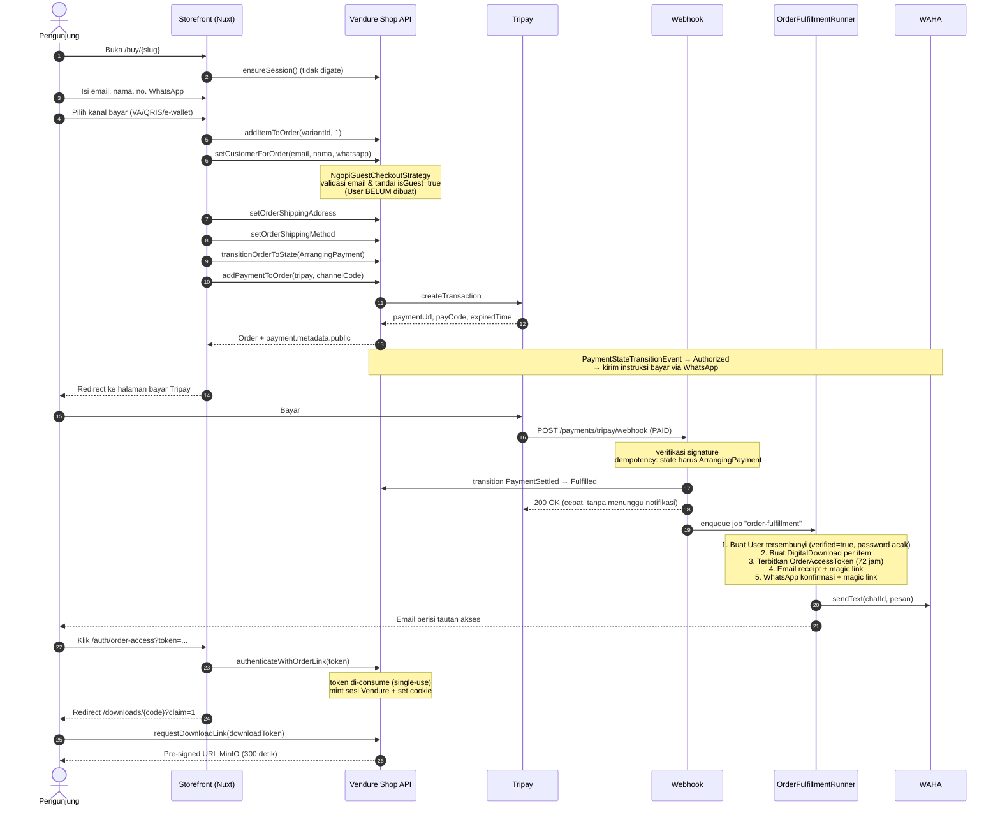
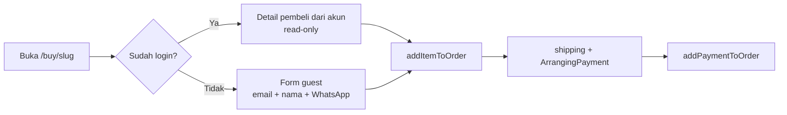
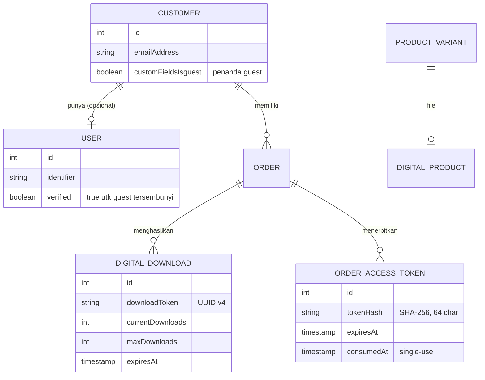
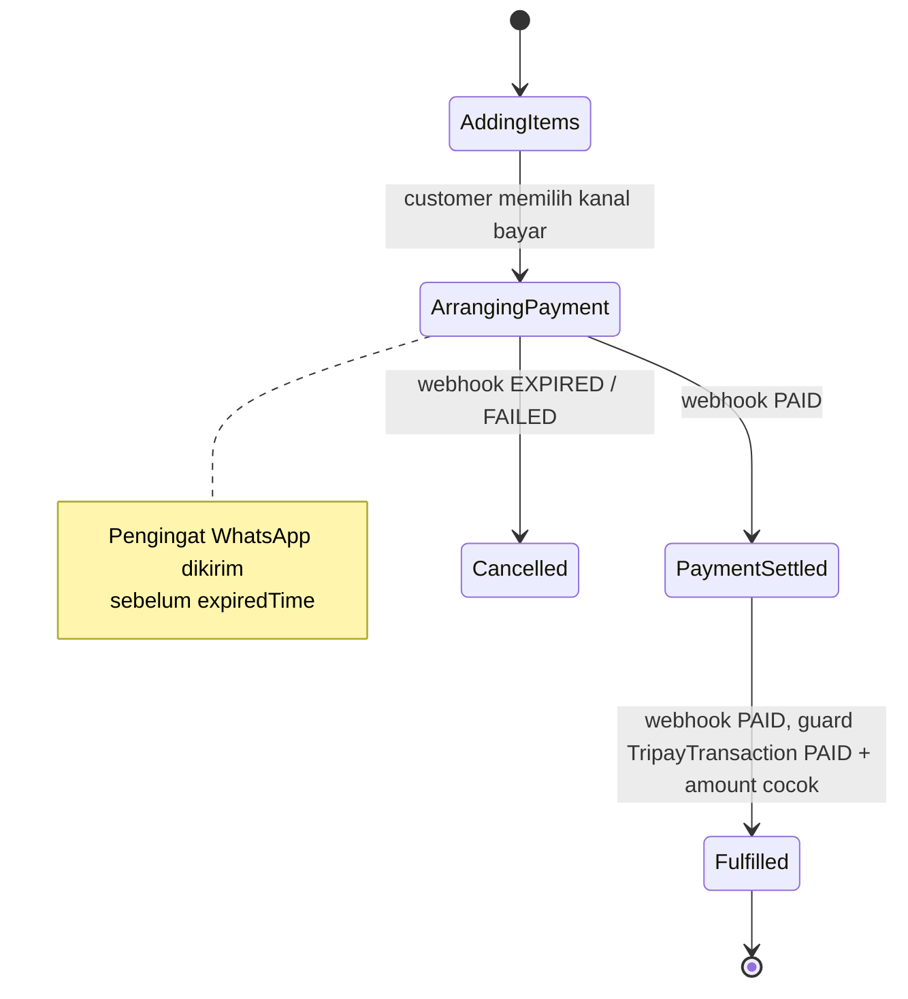
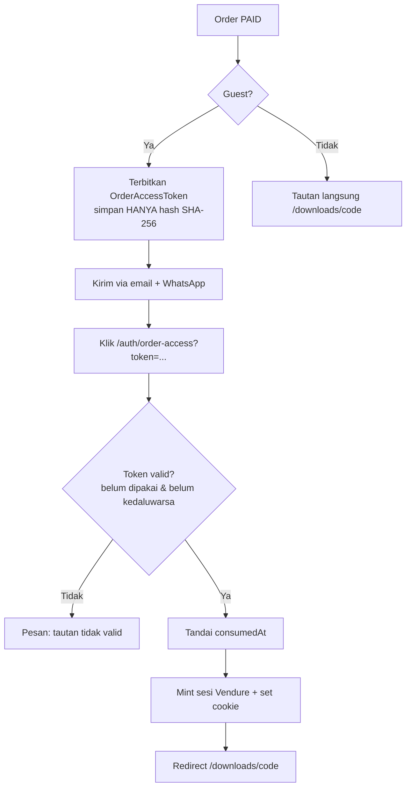
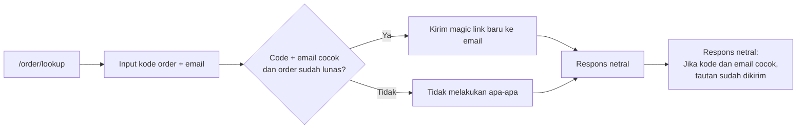
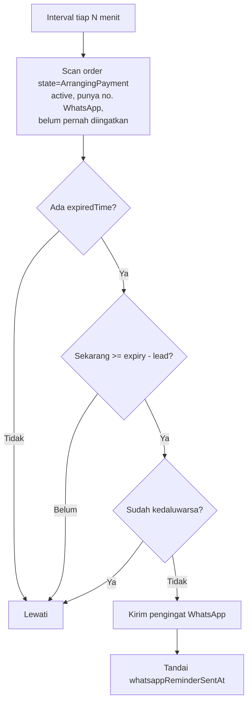

# Skema Pembelian — Guest & Registered

Dokumen ini menjelaskan alur pembelian NgopiCode Digital Store, termasuk mode
**guest** (beli tanpa login/mendaftar), model identitas, pengiriman produk,
integrasi WhatsApp (WAHA), serta sakelar operasional.

> Status: **terimplementasi**. Lihat referensi file di setiap bagian.

---

## 1. Ringkasan

Dua jalur pembelian didukung, keduanya berakhir di pengiriman digital yang sama:

| Jalur | Login? | Identitas | Tautan akses |
|-------|--------|-----------|--------------|
| **Registered** | Ya | Customer + `User` (password) | `/downloads/{code}` (sesi login) |
| **Guest** | Tidak | Customer tanpa `User` saat checkout; `User` tersembunyi dibuat saat pembayaran lunas | Magic link single-use via email + WhatsApp |

Prinsip desain:

1. **Guest tetap punya pemilik.** Akses download ditegakkan lewat
   `ctx.activeUserId` dan join `customer.userId → user.id`. Karena itu guest
   tetap dibuatkan `User`, hanya saja **lazy** (saat PAID) dan tanpa password
   yang diketahui siapa pun.
2. **Email adalah jalur utama, WhatsApp pelengkap.** Kegagalan WhatsApp tidak
   pernah menggagalkan email, fulfillment, atau pembayaran.
3. **Tidak ada kebocoran enumerasi.** Lookup order selalu membalas netral.
4. **Satu sakelar untuk mematikan.** Mematikan guest checkout **tidak**
   memutus akses pembelian lama.

---

## 2. Aktor & Kanal

| Aktor | Peran |
|-------|-------|
| Pengunjung (guest) | Membeli tanpa akun |
| Customer terdaftar | Membeli dengan akun |
| Vendure Shop API | Checkout, autentikasi, download |
| Tripay | Pembayaran (VA, e-wallet, QRIS) |
| Resend | Email transaksional |
| WAHA | WhatsApp HTTP API (`https://waha.ngopicode.com`) |
| MinIO | Penyimpanan file privat (pre-signed URL) |

---

## 3. Alur Pembelian Guest



### Catatan penting

- `setCustomerForOrder` **harus** dipanggil sebelum `ArrangingPayment`
  (order masih `AddingItems`).
- `User` tersembunyi **tidak** dibuat saat checkout. Ini mencegah `User` yatim
  dari cart yang ditinggalkan.
- Instruksi bayar dikirim dari event `PaymentStateTransitionEvent → Authorized`,
  bukan dari webhook, agar pelanggan menerima nomor VA segera.

> **Jangan pasang gate login di jalur pembelian.** Ada **dua** tempat yang bisa
> memblokir guest, dan keduanya harus bebas login:
>
> 1. `pages/products/[slug].vue` → `onBuyNow()` — halaman detail produk, tempat
>    tombol "Beli Sekarang" berada.
> 2. `pages/buy/[slug].vue` → halaman checkout itu sendiri.
>
> Keduanya pernah punya `if (!isLoggedIn) navigateTo('/auth')`. Yang di halaman
> detail mudah terlewat: memperbaiki halaman checkout saja tidak cukup, karena
> pengunjung tidak pernah sampai ke sana. Halaman akun (`pages/account/index.vue`)
> memang boleh mewajibkan login — itu bukan bagian dari jalur pembelian.

### Fulfillment lewat job queue

Webhook **tidak** menunggu pengiriman email/WhatsApp. Setelah transisi state
selesai, ia memasukkan job `order-fulfillment` ke antrean lalu langsung membalas
`200` ke Tripay (terukur ~0,3 detik; sebelumnya ~15 detik karena menunggu
WhatsApp).

Alasannya:

1. Tripay mengharapkan ack cepat; webhook yang lambat memicu retry tak perlu.
2. Pengiriman bisa gagal sementara. Antrean DB-backed (`DefaultJobQueuePlugin`)
   me-retry job alih-alih kehilangan notifikasi.
3. Job bersifat idempoten: pembuatan `DigitalDownload` dilewati bila sudah ada,
   jadi retry tidak menggandakan record.

Hasil job tersimpan di tabel `job_record` dan bisa diaudit:

```sql
SELECT "queueName", state, result FROM job_record
WHERE "queueName" = 'order-fulfillment' ORDER BY id DESC;
```

---

## 4. Alur Pembelian Registered

Perbedaannya hanya:



- Tidak ada `setCustomerForOrder`.
- `User` sudah ada → tidak ada pembuatan user tersembunyi.
- Tautan download: `/downloads/{code}` (bukan magic link), namun WhatsApp tetap
  menerima tautan halaman download + tautan bukti transaksi.

---

## 5. Model Identitas



### Tiga status akun

| Kondisi | `isGuest` | `User` | Perlakuan saat checkout guest |
|---------|-----------|--------|-------------------------------|
| Email belum pernah dipakai | `true` (dibuat) | tidak ada | Diterima sebagai guest |
| Email guest sebelumnya | `true` | ada (tersembunyi) | **Reuse** Customer yang sama |
| Email akun asli | `false` | ada (punya password) | **Ditolak** → `EmailAddressConflictError` → arahkan login / magic link |

`isGuest` disimpan sebagai `Customer.customFields.isGuest` (non-public, tidak
dibocorkan ke Shop API). Lihat `backend/src/vendure-config.ts`.

---

## 6. State Machine Order



Transisi hanya maju satu langkah (`backend/src/config/custom-order-process.ts`).
Guard menolak `Fulfilled` tanpa `TripayTransaction` berstatus `PAID` dengan
nominal yang cocok.

---

## 7. Pengiriman & Tautan Akses

### Tautan akses (magic link)



- **Single-use**: `consumedAt` diisi saat pertama kali ditukar. Percobaan kedua
  ditolak.
- **Umur 72 jam** (`GUEST_LINK_TTL_HOURS`), disamakan dengan masa berlaku
  download (`downloadExpiryHours`) agar pelanggan tidak kehilangan akses.
- **Bisa diminta ulang** lewat halaman lookup.

### Download

`requestDownloadLink(downloadToken)` memvalidasi kepemilikan, menaikkan
`currentDownloads`, lalu mengembalikan pre-signed MinIO URL berumur 300 detik.

Batas unduhan diambil dari record `digital_product` milik varian tersebut:

| Field | Nilai default entity | Yang benar-benar tersimpan saat upload via dashboard |
|-------|----------------------|------------------------------------------------------|
| `maxDownloadsPerOrder` | 5 | **999** (sentinel "unlimited") |
| `downloadExpiryHours` | 72 | **168** (7 hari) |

Angka di kolom kanan itulah yang dipakai pelanggan: uploader dashboard
(`uploadDigitalProduct`) menulis `999`/`168`, dan `OrderFulfillmentRunner`
menyalinnya ke setiap record `digital_download`.

> **Jebakan:** `digital_download.maxDownloads` punya CHECK constraint. Nilai
> `999` mensyaratkan batas atas **1000** — bukan 10 seperti spesifikasi awal.
> Batas `<= 10` membuat fulfillment gagal (`violates check constraint
> "CHK_digital_download_max_range"`) sehingga order berstatus `Fulfilled` tapi
> **tanpa download record**, dan tautan pelanggan membuka halaman kosong. Lihat
> migrasi `WidenDigitalDownloadMaxRange`.

---

## 8. Pemulihan (Recovery)

Guest tidak punya halaman akun, jadi ada jalur pemulihan sendiri:



**Respons selalu identik** baik cocok maupun tidak, sehingga tidak bisa dipakai
untuk menebak kode order atau email yang terdaftar.

### Klaim akun

Setelah masuk lewat magic link, pelanggan ditawari membuat password
(`setPasswordForGuest`). Karena `User` tersembunyi punya password acak yang
tidak diketahui siapa pun, mutasi ini **tidak meminta password lama**. Setelah
berhasil, `isGuest` diubah menjadi `false`.

---

## 9. Kanal Notifikasi

| Event | Email | WhatsApp | Pemicu |
|-------|-------|----------|--------|
| Instruksi pembayaran (VA/QRIS) | — | ✅ | `PaymentStateTransitionEvent → Authorized` |
| Konfirmasi pesanan + tautan akses | ✅ | ✅ | `OrderFulfillmentRunner` (setelah PAID) |
| Bukti transaksi | ✅ (di email) | ✅ (tautan struk) | Sama, disisipkan di pesan konfirmasi |
| Pengingat belum dibayar | — | ✅ | Pemindaian berkala (interval) |

### WAHA

- Base URL: `WAHA_BASE_URL` (default `https://waha.ngopicode.com`)
- Auth: header `X-Api-Key` berisi `WAHA_API_KEY`
- Sesi: `WAHA_SESSION` (default `default`)
- Format chat: `628xxxxxxxxxx@c.us` — nomor dinormalisasi otomatis dari
  `0812...`, `+62812...`, `62812...`, atau `812...`
  (`backend/src/plugins/whatsapp/utils/phone.ts`)

**Nama sesi tidak peka huruf besar/kecil.** WAHA bersifat case-sensitive saat
mengirim, dan ketidakcocokan hanya muncul sebagai error `Forbidden` yang tidak
informatif. Karena itu klien me-resolve nama sesi terhadap daftar sesi nyata
dari `GET /api/sessions` (di-cache 5 menit, dan di-reset bila pengiriman gagal).
Contoh: `WAHA_SESSION=default` tetap bekerja meski WAHA melaporkan `Default`.

**WhatsApp selalu best-effort.** Semua kegagalan (WAHA mati, timeout, nomor
tidak valid, sesi tidak `WORKING`) hanya menghasilkan log peringatan — tidak
melempar error dan tidak memblokir email maupun fulfillment.

### Pengingat belum dibayar



Dipilih interval biasa, **bukan** `DefaultSchedulerPlugin`, karena plugin itu
mendaftarkan cron job di registry global per-proses — bentrok ketika server dan
worker di-bootstrap dalam satu proses (model deployment proyek ini).

---

## 10. Sakelar Operasional

| Env | Default | Efek |
|-----|---------|------|
| `GUEST_CHECKOUT_ENABLED` | `true` | `false` → menolak guest checkout **baru** dan **tidak** menerbitkan magic link baru. Order lama tetap bisa dibuka (recovery tidak ikut mati). |
| `GUEST_LINK_TTL_HOURS` | `72` | Umur magic link |
| `WHATSAPP_ENABLED` | `false`* | Mengaktifkan notifikasi WhatsApp |
| `WAHA_API_KEY` | — | **Wajib.** Tanpa ini WhatsApp dianggap nonaktif walau flag `true` |
| `WHATSAPP_REMINDER_ENABLED` | `true` | Matikan bila worker dijalankan terpisah |
| `WHATSAPP_REMINDER_INTERVAL_MINUTES` | `15` | Frekuensi pemindaian |
| `WHATSAPP_REMINDER_LEAD_MINUTES` | `60` | Berapa lama sebelum kedaluwarsa pengingat dikirim |

\* `isWhatsappEnabled()` mengembalikan `false` bila `WAHA_API_KEY` kosong,
sehingga aman menyalakan flag sebelum kredensial diisi.

> **Deployment:** `docker-compose.yml` meneruskan env ke container Vendure
> memakai **allow-list**, bukan seluruh berkas `.env`. Semua variabel di atas
> sudah didaftarkan di sana dengan nilai default yang aman. Bila menambah
> variabel baru, daftarkan juga di `docker-compose.yml` — kalau tidak, nilainya
> tidak akan sampai ke container (gejalanya: fitur aktif di lokal tapi mati di
> produksi).

> **Konfigurasi toko (currency, pajak, shipping):** lihat
> [store-setup.md](./store-setup.md). Jalankan `node scripts/setup-store.js`
> sekali per environment. Tanpa itu, checkout gagal untuk semua pembeli.

---

## 11. Permukaan API (Shop API)

```graphql
extend type Mutation {
  # Guest checkout
  setCustomerForOrder(input: CreateCustomerInput!): SetCustomerForOrderResult!

  # Pemulihan & akses
  requestOrderAccessLink(orderCode: String!, emailAddress: String!): RequestOrderAccessLinkResult!
  authenticateWithOrderLink(token: String!): OrderAccessAuthResult!

  # Klaim akun (butuh sesi)
  setPasswordForGuest(newPassword: String!): SetGuestPasswordResult!
}
```

`requestOrderAccessLink` dan `authenticateWithOrderLink` bersifat `Public`.
`setPasswordForGuest` memakai `Permission.Owner`.

---

## 12. Pemetaan Error → Pesan UI

| Kondisi | Error | Perilaku storefront |
|---------|-------|---------------------|
| Email sudah punya akun asli | `EmailAddressConflictError` | "Email ini sudah terdaftar. Silakan masuk atau minta tautan akses." |
| Kill switch mati | `GuestCheckoutError` | Tampilkan `errorDetail`; arahkan login |
| Sudah login tapi isi form guest | `AlreadyLoggedInError` | Form guest tidak ditampilkan |
| Tidak ada order aktif | `NoActiveOrderError` | Minta muat ulang |
| Token tidak valid/terpakai | respons `success: false` | Arahkan ke `/order/lookup` |

---

## 13. Edge Case yang Ditangani

| Kasus | Perlakuan |
|-------|-----------|
| Cart ditinggalkan sebelum bayar | Tidak ada `User` yatim — `User` baru dibuat saat PAID |
| Webhook Tripay dikirim ulang | Idempotent: dilewati bila state ≠ `ArrangingPayment` |
| Email salah ketik | Pemulihan via `/order/lookup`; link bisa dikirim ulang |
| Magic link bocor/diteruskan | Single-use + umur terbatas |
| Nomor WhatsApp tidak valid | Dilewati dengan log; email tetap terkirim |
| WAHA mati | Log peringatan; email & fulfillment tetap jalan |
| Email konfirmasi gagal kirim | Order tetap `Fulfilled` (tidak di-rollback) |
| Pembayaran kedaluwarsa | Webhook menandai `Cancelled`; pengingat tidak dikirim bila sudah lewat |
| Guest beli lagi dengan email sama | Reuse Customer yang sama (`isGuest` masih `true`) |
| Guest mengklaim akun lalu beli lagi | `isGuest=false` → diperlakukan akun normal |

---

## 14. Referensi Berkas

**Backend**

| Berkas | Isi |
|--------|-----|
| `src/config/guest-checkout.ts` | Kill switch & TTL magic link |
| `src/config/guest-checkout-strategy.ts` | `NgopiGuestCheckoutStrategy` |
| `src/config/whatsapp.ts` | Konfigurasi WAHA & reminder |
| `src/plugins/guest-checkout/` | Entity token, service akses, resolver, email |
| `src/plugins/whatsapp/` | Klien WAHA, service, template, notifier |
| `src/plugins/digital-fulfillment/services/order-fulfillment-runner.service.ts` | Fulfillment nyata |
| `src/plugins/digital-fulfillment/services/order-fulfillment-queue.service.ts` | Antrean job fulfillment (retry) |
| `src/plugins/tripay-payment/services/tripay-webhook.service.ts` | Otak webhook |
| `src/config/custom-order-process.ts` | Guard transisi state |

**Frontend**

| Berkas | Isi |
|--------|-----|
| `pages/buy/[slug].vue` | Checkout (guest + registered) |
| `pages/auth/order-access.vue` | Penukaran magic link |
| `pages/order/lookup.vue` | Pemulihan / minta tautan |
| `pages/downloads/[orderCode].vue` | Download + prompt klaim akun |
| `pages/order/[code].vue` | Status pesanan (guest-tolerant) |
